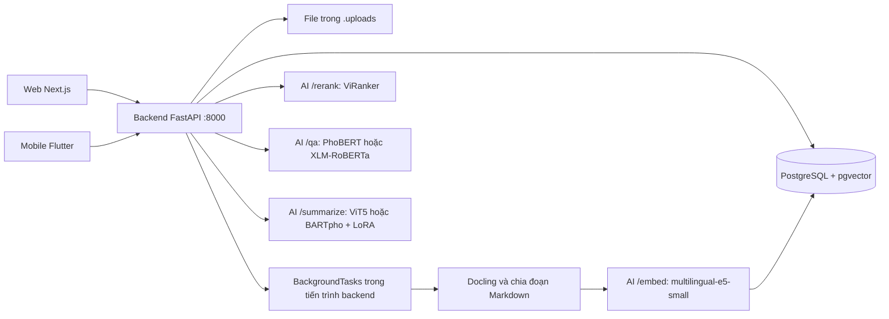
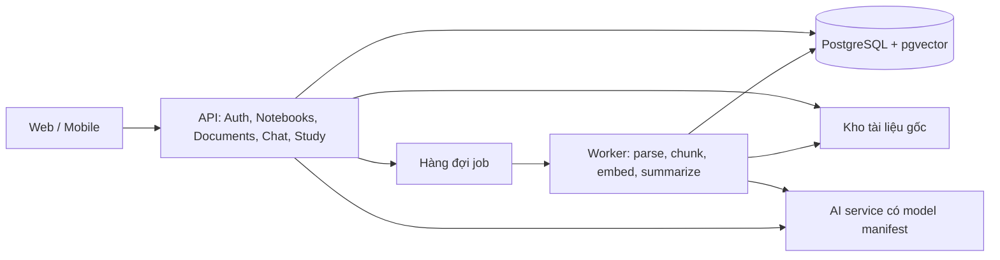

# Phân tích mã nguồn và hướng phát triển DocuMind

> Đây là đánh giá trước khi triển khai giai đoạn 1. Các thay đổi sau đánh giá được ghi tại [hướng dẫn giai đoạn 1](PHASE1_IMPLEMENTATION_VI.md).

Ngày đánh giá: 04/11/2026. Phạm vi: bản mã nguồn trong workspace `D:/Projects/DocuMind`.

## 1. Nhận định chính

DocuMind có nền tảng phù hợp để phát triển thành trợ lý học tập bằng tiếng Việt: quản lý sổ tay, nhập tài liệu, tìm kiếm ngữ nghĩa, hỏi đáp trích xuất và tóm tắt, với hai giao diện web/mobile dùng chung backend.

Hiện trạng phù hợp với một prototype tích hợp phục vụ nghiên cứu/demo. Chưa nên mở rộng cho người dùng thật trước khi hoàn thiện xác thực, phân quyền, migration, hợp đồng API và độ chính xác của nguồn trích dẫn. Đây là đánh giá từ mã nguồn và các kiểm tra cục bộ, không phải kết quả kiểm thử một hệ thống production đang chạy.

Ưu tiên phát triển: **độ đúng và khả năng vận hành của luồng đọc tài liệu → chất lượng trả lời có bằng chứng → công cụ ôn tập**. Tiếp tục mở rộng giao diện trước khi xử lý các vấn đề nền tảng sẽ làm tăng chi phí sửa ở cả web và mobile.

## 2. Phạm vi khảo sát và giới hạn

- Khảo sát cây file được Git quản lý; đọc các entry point, router, model/schema, migration, pipeline xử lý tài liệu, dịch vụ AI, mã training/evaluation, API client và các luồng giao diện chính, CI/Docker và tài liệu thiết lập.
- Thống kê 151 file thuộc các đuôi `.py`, `.dart`, `.tsx`, `.ts`, `.js`, `.css`, `.html`, `.yaml`, `.yml`, tổng cộng khoảng 22.095 dòng. Con số này gồm cấu hình, không đại diện cho toàn bộ file trong repository.
- Kiểm tra cú pháp toàn bộ file Python được Git quản lý bằng AST; chạy ESLint và TypeScript; thử production build web và phân tích tĩnh Dart.
- Tái hiện lỗi token bằng hàm thật với session database giả và bộ băm mật khẩu được thay thế trong bộ nhớ. Không gửi email, gọi AI hay thay đổi database thật.
- Không chạy huấn luyện/inference đầy đủ: bốn thư mục artifact mô hình mà service yêu cầu đều không có trong workspace; môi trường Python hiện tại thiếu `pyvi` và `pytest`.
- Không thực hiện migration trên database cấu hình trong `.env`; không chạy script reset database. Các nhận định migration dưới đây dựa trên chuỗi migration đã đọc.
- Không đánh giá trực quan mọi màn hình trên thiết bị, kiểm thử iOS, tải đồng thời, chất lượng OCR hoặc độ chính xác AI bằng một bộ dữ liệu đầy đủ. Không audit từng nội dung binary, ảnh, JAR hay dependency đã sinh.

| Thành phần | File trong thống kê | Dòng | Vai trò |
| --- | ---: | ---: | --- |
| `backend` | 29 | 2.173 | FastAPI, SQLModel, PostgreSQL/pgvector, API và xử lý tài liệu |
| `ai` | 38 | 3.416 | Inference, cấu hình mô hình, training/evaluation, xử lý dữ liệu |
| `mobile` | 40 | 9.321 | Flutter, luồng học tập, xác thực, bản dịch và widget dùng chung |
| `web` | 28 | 4.832 | Next.js/React/TypeScript, dashboard và API client |
| `landing_page` | 3 | 1.473 | Trang giới thiệu HTML/CSS/JS |
| `tests` | 7 | 564 | Chủ yếu script kiểm tra AI/tích hợp thủ công |
| `scripts` | 2 | 63 | Debug và reset database |
| Root và CI | 4 | 253 | Entry point, cấu hình triển khai và workflow |

## 3. Kiến trúc thực tế

Luồng hỏi đáp: tạo embedding câu hỏi → lấy 20 đoạn trong sổ tay theo cosine distance → rerank còn 3 → ghép context → mô hình QA chọn span → mở rộng thành câu → gắn trích dẫn → lưu `QAHistory` và `Citation`.

Luồng tóm tắt: đọc chunks trong sổ tay → sắp theo UUID tài liệu/trang/UUID chunk → lấy 800 từ đầu → AI tiếp tục giới hạn 512 token → sinh bản tóm tắt. Vì vậy chức năng hiện tại chưa bao phủ một sổ tay dài.

Database đã có `User`, `Notebook`, `Document`, `DocumentChunk`, `Summary`, `QAHistory`, `Citation`, `Notification`. Chưa có mô hình dữ liệu cho bộ flashcard, thẻ, phiên ôn tập và lịch ôn. `Summary` có model nhưng luồng tóm tắt hiện không lưu kết quả vào bảng này. Backend lưu lịch sử QA nhưng chưa có API đọc/xóa lịch sử để hai client sử dụng.

### Điểm nên giữ

- Backend và AI đã có ranh giới HTTP, thuận lợi để scale và đo hiệu năng riêng.
- PostgreSQL quản lý cả quan hệ và vector, tránh tăng số dịch vụ khi chưa cần thiết.
- Embedding E5 dùng tiền tố query/passage và chuẩn hóa L2; kích thước 384 thống nhất với model hiện tại.
- Retrieval có giới hạn theo notebook và bước reranking; đây là nền tảng tốt để nâng chất lượng có kiểm chứng.
- Phần lớn API tài liệu, cập nhật/xóa sổ tay và thông báo đã kiểm tra chủ sở hữu.
- Mobile đã dùng secure storage; có localization, widget chung, trạng thái tải và polling tiến trình tài liệu.
- Web đã gom API client, auth context và notebook context; ESLint/TypeScript hiện chạy qua.
- Đã có mã nghiên cứu cho hai mô hình QA và hai mô hình tóm tắt, kèm cấu hình và logging.

## 4. Các vấn đề ưu tiên

Quy ước: P0 cần xử lý trước khi cho người dùng thật truy cập; P1 cần xử lý để có bản beta đáng tin cậy; P2 là cải thiện sau khi nền tảng hoạt động đúng. Mức ưu tiên là đề xuất cho dự án này.

### F01 — P0: Chưa tách biệt mục đích token

`get_current_user` chỉ kiểm tra chữ ký/hạn JWT và `sub`, không yêu cầu `type=access`. `/verify-otp` tạo reset token bằng chính hàm tạo access token. `/reset-password` không yêu cầu token dành riêng cho reset và không kiểm tra token đã được sử dụng.

Đã tái hiện bằng session giả: refresh JWT được chấp nhận trong `get_current_user`; cả access JWT lẫn refresh JWT được chấp nhận để đặt mật khẩu mới. Điều này làm tăng tác hại khi token bị lộ; kiểm tra refresh token trong database khi refresh/logout không bảo vệ được đường xử lý đang chỉ decode JWT.

Sửa: tách access/refresh/password_reset; kiểm tra mục đích ở từng endpoint; reset challenge một lần dùng có hạn ngắn; quản lý phiên và hash refresh token; xác định chính sách thu hồi phiên khi đổi/reset mật khẩu. Bổ sung test token sai mục đích, hết hạn, dùng lại và đã thu hồi.

Nguồn: [deps.py:15](<D:/Projects/DocuMind/backend/app/api/deps.py:15>), [auth.py:213](<D:/Projects/DocuMind/backend/app/api/auth.py:213>), [security.py](<D:/Projects/DocuMind/backend/app/core/security.py>).

### F02 — P0: Đọc chi tiết sổ tay không yêu cầu xác thực

`GET /notebooks/{notebook_id}` thiếu `get_current_user` và kiểm tra chủ sở hữu. Người biết UUID có thể đọc metadata sổ tay, gồm tiêu đề và user ID. Phát hiện này không đồng nghĩa họ đọc được nội dung tài liệu; các API tài liệu có kiểm tra quyền riêng.

Sửa: áp dụng dependency kiểm tra quyền dùng chung cho toàn bộ route theo notebook/document; test bằng hai người dùng và client không đăng nhập. Không dùng `is_private` làm cơ chế chia sẻ khi chưa có mô hình quyền.

Nguồn: [notebooks.py:35](<D:/Projects/DocuMind/backend/app/api/notebooks.py:35>).

### F03 — P0: API vận hành và log đang lộ quá nhiều thông tin

`/init-db` cho phép gọi GET/POST không xác thực để thực hiện DDL. `/health` trả danh sách bảng, cột và thông báo lỗi. Mobile in toàn bộ response body, bao gồm token trong phản hồi đăng nhập/reset mật khẩu. Config còn secret mặc định và CORS chấp nhận mọi origin; cần chặn cấu hình mặc định khi triển khai, không kết luận `.env` đang dùng secret mặc định.

Sửa: đưa migration ra bước triển khai; bỏ route DDL công khai; tách liveness/readiness với phản hồi tối giản; log có cấu trúc và che token; khai báo origin cụ thể và secret bắt buộc.

Nguồn: [backend/main.py:48](<D:/Projects/DocuMind/backend/main.py:48>), [base_api_service.dart:31](<D:/Projects/DocuMind/mobile/lib/core/base_api_service.dart:31>), [config.py](<D:/Projects/DocuMind/backend/app/core/config.py>).

### F04 — P1: Luồng quên mật khẩu trên web đọc sai hợp đồng API

Backend trả `{reset_token: ...}` sau verify OTP, nhưng web đọc `verifyRes.token || verifyRes.access_token || otpCode`. Theo hợp đồng hiện tại, web sẽ gửi mã OTP sáu chữ số đến endpoint cần JWT, nên bước reset thất bại sau khi OTP đúng đã bị tiêu thụ. Sau reset cũng cần đồng bộ lại `AuthContext` trước khi chuyển về dashboard; hiện chỉ lưu token trong API client.

Sửa trường `reset_token`, bỏ fallback sang OTP; dùng response type rõ ràng; thêm kiểm thử luồng quên mật khẩu hoàn chỉnh trên cả hai client.

Nguồn: [reset-password/page.tsx:46](<D:/Projects/DocuMind/web/src/app/(auth)/reset-password/page.tsx:46>), [auth.py:228](<D:/Projects/DocuMind/backend/app/api/auth.py:228>).

### F05 — P1: Refresh tự động không khớp mã lỗi backend

Backend trả 403 cho JWT lỗi/hết hạn; cả web và mobile chỉ refresh khi nhận 401. Phiên có thể bị mất dù refresh token còn hạn. Hai client chưa điều phối một lần refresh chung khi nhiều request đồng thời bị hết hạn; với rotation phía server, cần tránh các lần refresh cạnh tranh nhau.

Sửa: thống nhất 401 cho thiếu/hết hạn xác thực, 403 cho thiếu quyền; thêm cơ chế gộp refresh đang chạy; không tự retry các lỗi sai mật khẩu của endpoint login bằng interceptor refresh chung.

Nguồn: [deps.py:26](<D:/Projects/DocuMind/backend/app/api/deps.py:26>), [api.ts:52](<D:/Projects/DocuMind/web/src/lib/api.ts:52>), [api_service.dart](<D:/Projects/DocuMind/mobile/lib/core/api_service.dart>).

### F06 — P1: Chuỗi migration không khởi tạo được database trống theo thiết kế hiện tại

Migration đầu tiên chỉ `ALTER notebooks`, không tạo bảng nền. Các migration tiếp theo giả định `users`, `documents`, `qa_history`, `citations`... đã tồn tại. Migration tên “add qa_history and citations tables” thực tế chỉ đổi chiều vector. Docker Compose chạy `alembic upgrade head` trước khi server có cơ hội `create_all`, nên database mới sẽ gặp lỗi bảng không tồn tại.

Sửa: tạo baseline schema đầy đủ, gồm extension vector và constraints; phân biệt đường nâng cấp database cũ với khởi tạo mới. Không xóa/viết lại lịch sử đã triển khai khi chưa có kế hoạch chuyển đổi. Kiểm thử cả database trống và database có dữ liệu; đổi chiều embedding cần tái sinh vector, không chỉ ALTER cột. Dùng Alembic làm nguồn quản lý schema duy nhất thay vì tự tạo bảng và bỏ qua lỗi ở startup.

Nguồn: [migration gốc:25](<D:/Projects/DocuMind/backend/alembic/versions/0e0402c01692_init.py:25>), [migration vector](<D:/Projects/DocuMind/backend/alembic/versions/14b991113703_add_qa_history_and_citations_tables.py>), [docker-compose.yml:55](<D:/Projects/DocuMind/docker-compose.yml:55>).

### F07 — P1: Chưa giữ đúng vị trí nguồn và thứ tự đoạn

Processor chuyển toàn tài liệu thành Markdown rồi chia đoạn, không truyền số trang trong metadata. Document service mặc định `page_num=1`, nên chunks do pipeline này tạo đều có trang 1. `chunk_index` chỉ có trong kết quả tạm, reset theo section và không được lưu vào model. Các truy vấn sau đó sắp bằng UUID ngẫu nhiên, khiến thứ tự đoạn trong cùng trang không phản ánh tài liệu gốc.

Sửa: lấy provenance từ cấu trúc Docling; lưu thứ tự đoạn toàn tài liệu, trang bắt đầu/kết thúc, section, offsets và vị trí bảng khi có. Với DOCX/TXT không có trang ổn định, hiển thị section/đoạn hoặc “không rõ trang” thay vì tự gán trang 1. Bổ sung API mở tài liệu gốc tại vị trí nguồn.

Nguồn: [document_processor.py:107](<D:/Projects/DocuMind/backend/processor/document_processor.py:107>), [document_service.py:35](<D:/Projects/DocuMind/backend/app/services/document_service.py:35>), [rag_service.py:251](<D:/Projects/DocuMind/backend/app/services/rag_service.py:251>).

### F08 — P1: Tóm tắt chỉ bao phủ phần đầu và chưa lưu kết quả

Backend lấy 800 từ đầu; AI chỉ nhận tối đa 512 token. Nội dung phía sau không được tóm tắt. Việc sắp chunks bằng UUID còn có thể khiến “phần đầu” không đúng thứ tự bản gốc; overlap giữa chunks cũng được ghép lại nguyên trạng. Kết quả không được lưu/cache theo phiên bản tài liệu.

Sửa: tóm tắt từng section/chunk theo token budget → tổng hợp theo tài liệu → tổng hợp theo notebook. Lưu coverage, phiên bản pipeline/model và nguồn; xử lý overlap; làm mất hiệu lực bản tóm tắt khi nguồn thay đổi.

Nguồn: [rag_service.py:264](<D:/Projects/DocuMind/backend/app/services/rag_service.py:264>), [summarization_service.py:141](<D:/Projects/DocuMind/ai/services/summarization_service.py:141>).

### F09 — P1: Web chọn sai model và hiển thị sai cấu trúc trích dẫn/thông báo

- Web gửi `xlm_roberta`; AI chỉ nhận `xlmroberta_qa` và âm thầm fallback sang PhoBERT. Người dùng tưởng đã đổi model nhưng backend có thể vẫn chạy PhoBERT.
- Backend trả `page_number`, `source_title`, `snippet`; web đọc `cite.page` và type khai báo các trường khác, nên thường hiển thị trang 1 và không sử dụng đầy đủ nguồn.
- Thông báo backend trả `body`; web khai báo/đọc `message`, nên nội dung thông báo không xuất hiện đúng.
- Danh sách notebook chưa trả số tài liệu; web fallback 0, mobile có chỗ gán `count: 0`. Category chủ yếu suy ra từ tên, không phải trường dữ liệu đã lưu.

Sửa: OpenAPI là nguồn hợp đồng; sinh type/client hoặc ít nhất kiểm tra response ở ranh giới; enum model chung và từ chối giá trị không hỗ trợ bằng 422. Thêm endpoint capabilities cho model thực sự sẵn sàng.

Nguồn: [ai-chat/page.tsx:158](<D:/Projects/DocuMind/web/src/app/(dashboard)/ai-chat/page.tsx:158>), [trích dẫn web:278](<D:/Projects/DocuMind/web/src/app/(dashboard)/ai-chat/page.tsx:278>), [NotificationDrawer.tsx:145](<D:/Projects/DocuMind/web/src/components/notifications/NotificationDrawer.tsx:145>), [types/index.ts](<D:/Projects/DocuMind/web/src/types/index.ts>).

### F10 — P1: Xử lý nền chưa bền vững và chưa phục hồi giao dịch lỗi

`BackgroundTasks` chạy trong tiến trình API; chưa có queue bền vững, cơ chế retry, nhận lại job sau restart hay chống xử lý trùng. Processor mới được tạo cho từng tài liệu. Nhánh `except` tiếp tục dùng session và commit mà không rollback; nếu lỗi gốc là flush/commit database, bước ghi trạng thái lỗi có thể tiếp tục thất bại. Xóa tài liệu trong lúc xử lý cũng cần được điều phối.

Sửa: job có trạng thái queued/processing/ready/failed, attempt, error_code, heartbeat; worker riêng; giao dịch rõ ràng; rollback trước khi ghi lỗi hoặc dùng session mới; thay thế chunks theo document version để retry không tạo bản sao. Đồng bộ vòng đời file với database, có bước dọn file mồ côi.

FastAPI cũng hướng dẫn cân nhắc công cụ xử lý nền bên ngoài cho tác vụ tính toán nặng. [Tài liệu FastAPI](https://fastapi.tiangolo.com/tutorial/background-tasks/). Sau lỗi flush, SQLAlchemy yêu cầu rollback rõ ràng trước khi tái sử dụng session. [Tài liệu SQLAlchemy](https://docs.sqlalchemy.org/en/20/orm/session_basics.html).

Nguồn: [document_service.py](<D:/Projects/DocuMind/backend/app/services/document_service.py>), [documents.py](<D:/Projects/DocuMind/backend/app/api/documents.py>).

### F11 — P1: Chưa có cơ sở đánh giá AI tái lập và đáng tin cậy

- Training/evaluation import `src.data.data_loader`, `process_qa`, `process_sum`, nhưng `ai/src/data` không tồn tại trong checkout.
- `train_qa.py`, `eval/eval_qa.py` và `src/eval_qa.py` đánh giá validation nhưng ghi nhãn/prefix “test”. Chưa thể coi đây là kết quả trên tập test độc lập.
- `QAMetrics` tính F1 bằng giao các vị trí token trong từng feature; chưa phải text EM/F1 sau chuẩn hóa và gộp các cửa sổ theo câu hỏi.
- Train, inference và script test dùng nhiều đường checkpoint khác nhau: `best`, `best_model`, `checkpoint-3750`; inference BARTpho ghim một checkpoint cụ thể thay vì manifest artifact.
- Config nghiên cứu dùng Vietnews/ViQuAD. Chất lượng trên bài giảng, công thức, bảng và tài liệu người dùng là giả thuyết cần đo, không suy ra trực tiếp từ kết quả trên dữ liệu tin tức/QA.

Sửa: khôi phục module data; chuẩn hóa preprocessing; đóng gói tokenizer cùng model/adapter; lưu model revision, checksum, cấu hình và dataset split. Tách validation để chọn model và test để báo cáo. Đánh giá thêm retrieval, reranker, độ đúng nguồn và câu hỏi không có đáp án. Hướng dẫn QA chính thức minh họa dùng offset/sequence mapping để gắn span vào context. [Hugging Face QA](https://huggingface.co/docs/transformers/tasks/question_answering).

Nguồn: [train_qa.py:138](<D:/Projects/DocuMind/ai/src/train/train_qa.py:138>), [eval_qa.py:55](<D:/Projects/DocuMind/ai/src/eval/eval_qa.py:55>), [metric_qa.py:42](<D:/Projects/DocuMind/ai/src/metrics/metric_qa.py:42>), [ai/configs](<D:/Projects/DocuMind/ai/configs>).

### F12 — P1: Trích dẫn và từ chối trả lời cần dựa trên bằng chứng

Khi đáp án không khớp chunk nào, RAG tự chọn chunk đầu tiên làm nguồn. QA dùng tổng logits với ngưỡng cố định 1.0; đây không phải xác suất đã hiệu chỉnh cho mọi model. Ghép nhiều chunks rồi decode đáp án làm mất vị trí nguồn chính xác; tìm lại bằng chuỗi là dễ sai. Chưa có ngưỡng retrieval/reranker được đánh giá cho câu hỏi ngoài phạm vi.

Sửa: trả span offsets, chunk/document ID và score từ tầng QA; chỉ gắn nguồn chứng minh được đáp án; hiệu chỉnh điều kiện từ chối trên bộ validation có câu hỏi không có đáp án. Tách “đoạn liên quan” khỏi “nguồn chứng minh câu trả lời”.

Nguồn: [rag_service.py:177](<D:/Projects/DocuMind/backend/app/services/rag_service.py:177>), [qa_service.py](<D:/Projects/DocuMind/ai/services/qa_service.py>).

### F13 — P1: Giới hạn tài nguyên và triển khai chưa hoàn chỉnh

Upload chưa có giới hạn kích thước, kiểm tra nội dung/MIME và quota ở backend; copy file đồng bộ nằm trong route async. `/embed` nhận toàn bộ chunks trong một batch không có giới hạn. Các route AI là async nhưng gọi inference đồng bộ ngay trong event loop. Lazy loading chưa có điều phối tải/concurrency; embedding được tải ngay lúc import, phụ thuộc cache/mạng khi khởi động.

Compose công khai port AI 8001 trong khi AI không có xác thực. `render.yaml` mới mô tả backend/database, chưa khai báo AI service và `AI_SERVICE_URL`, kho file bền vững hoặc worker. Không thể coi manifest này là triển khai đầy đủ toàn hệ thống. Dockerfile backend copy lockfile nhưng dùng `uv pip install .`, chưa cài theo lockfile frozen; AI requirements còn gộp training và serving.

Sửa: validate file và text ở server, batch theo token/giới hạn bộ nhớ, admission control cho inference, giới hạn concurrency; readiness dựa trên artifact cần dùng; dịch vụ AI trong mạng riêng. Tách dependency API/processor/AI serving/training; build tái lập, pin model revision và image; bổ sung volume/storage, backup/restore và cấu hình môi trường.

Nguồn: [documents.py:16](<D:/Projects/DocuMind/backend/app/api/documents.py:16>), [ai/main.py](<D:/Projects/DocuMind/ai/main.py>), [embedding_service.py](<D:/Projects/DocuMind/ai/services/embedding_service.py>), [render.yaml](<D:/Projects/DocuMind/render.yaml>), [Dockerfile backend](<D:/Projects/DocuMind/backend/Dockerfile>).

### F14 — P1: CI và test chưa bảo vệ các luồng quan trọng

Backend CI cho phép bước cài dependency thất bại qua `|| true`, rồi chỉ compile thư mục `app`, bỏ qua processor/AI và không chạy test API/migration. Một số file trong `tests` là demo load mô hình ngay khi import; một số bắt exception và chỉ in lỗi, nên không tạo tín hiệu fail đáng tin cậy. Test Docling còn đọc `metadata['source']` mà processor hiện không tạo. Test Flutter hiện kiểm tra màu và một widget mẫu, chưa đi qua ứng dụng thật.

Sửa: bỏ việc nuốt lỗi cài đặt; test unit API bằng AI giả; integration dùng PostgreSQL/pgvector riêng; migration từ database trống; test hợp đồng và các luồng login/upload/chat/reset. Để model benchmark nặng ở job riêng, có artifact cố định.

Nguồn: [ci.yml:57](<D:/Projects/DocuMind/.github/workflows/ci.yml:57>), [tests](<D:/Projects/DocuMind/tests>), [widget_test.dart](<D:/Projects/DocuMind/mobile/test/widget_test.dart>).

### F15 — P2: Flashcard và một số hành động còn là demo

Web sử dụng ba `SAMPLE_CARDS`, không sinh theo tài liệu và chưa lưu tiến độ. Mobile chuyển action Flashcards sang `SummaryScreen`, gọi summarize nhưng hiển thị câu hỏi theo chuỗi dịch mẫu; nút Flashcards tại chi tiết notebook còn callback rỗng. Chat chỉ giữ messages cục bộ và không gửi lịch sử trong request, nên hiện chủ yếu là QA từng lượt, chưa có ngữ cảnh hội thoại nhiều lượt. Hiệu ứng “streaming” mobile là timer chạy sau khi nhận toàn bộ đáp án.

Sửa: hiển thị rõ tính năng demo; xây API flashcard riêng với nguồn, chỉnh sửa và lịch ôn; bổ sung session/message history trước khi hứa hẹn hội thoại. Mobile timer cần gắn với message ID và hủy khi đổi notebook để tránh ghi vào `_messages.last` của cuộc hội thoại khác.

Nguồn: [flashcards/page.tsx](<D:/Projects/DocuMind/web/src/app/(dashboard)/flashcards/page.tsx>), [summary_screen.dart](<D:/Projects/DocuMind/mobile/lib/features/ai/summary_screen.dart>), [ai_chat_screen.dart](<D:/Projects/DocuMind/mobile/lib/features/ai/ai_chat_screen.dart>).

### F16 — P2: Mobile, web và landing cần chuẩn hóa để phát hành

- Mobile hardcode localhost/HTTP, Android cho cleartext và release ký bằng debug key. Cần cấu hình dev/staging/prod, HTTPS và signing riêng trước phát hành.
- Web dùng localStorage cho refresh token; nên thiết kế phiên web với cookie HttpOnly/Secure và kiểm soát CSRF phù hợp nếu chuyển sang cookie. Mobile tiếp tục secure storage.
- Web timeout chung 60 giây, nhưng backend có thể chờ summarize 180 giây. Cần job API cho tác vụ dài và timeout theo thao tác; mobile cũng cần timeout rõ ràng.
- Các màn Flutter lớn 600–900 dòng, trộn UI/state/network; cần tách dần theo feature, model có kiểu và controller/repository, tránh viết lại toàn bộ.
- Một số chuỗi mobile vẫn hardcode ngoài localization; auth khởi động chỉ kiểm tra có token, chưa xác thực phiên thật.
- Landing có CTA chưa nối ứng dụng, menu mobile chỉ alert và link `#`. Handler gọi `querySelector('#')` có thể phát sinh lỗi selector khi bấm link placeholder; cần sửa cùng luồng điều hướng.
- Tài liệu kiến trúc còn mô tả lựa chọn FastAPI/NestJS, vector 1536 và các tính năng chưa có, khác implementation hiện tại. Root `main.py` chỉ in lời chào; nên thống nhất entry point và hướng dẫn chạy đủ backend/AI.

Nguồn: [constants.dart](<D:/Projects/DocuMind/mobile/lib/core/constants.dart>), [Android build:37](<D:/Projects/DocuMind/mobile/android/app/build.gradle.kts:37>), [api.ts:11](<D:/Projects/DocuMind/web/src/lib/api.ts:11>), [landing main.js](<D:/Projects/DocuMind/landing_page/main.js>), [ARCHITECTURE.md](<D:/Projects/DocuMind/docs/en/ARCHITECTURE.md>).

## 5. Hướng sản phẩm nên tập trung

Định vị đề xuất: **Trợ lý đọc và ôn tập tài liệu tiếng Việt có thể kiểm tra nguồn**. Chọn sinh viên/người học là nhóm thử nghiệm đầu tiên vì cấu trúc notebook, mascot, từ ngữ và luồng hiện tại đã hướng về nhóm này. Đây là định hướng từ codebase, chưa phải kết luận nghiên cứu thị trường.

Một hành trình hoàn chỉnh nên là: tạo môn học → tải bài giảng → biết tiến độ xử lý → đọc tóm tắt đủ tài liệu → hỏi nội dung cụ thể → mở đúng nguồn → lưu thành ghi chú/thẻ ôn → quay lại ôn tập.

Thứ tự tính năng:

1. Hỏi đáp đúng nguồn, mở được tài liệu gốc và từ chối khi không đủ bằng chứng.
2. Tóm tắt theo tài liệu/chương/toàn notebook, có trạng thái và lịch sử.
3. Lưu hội thoại, ghi chú cá nhân và tìm lại kiến thức.
4. Flashcard/quiz có nguồn, chỉnh sửa được và lịch ôn lặp lại.
5. Chia sẻ nhóm theo quyền và cộng tác sau khi mô hình phân quyền đã hoàn chỉnh.

Giữ QA trích xuất như chế độ tìm đáp án ngắn. Với yêu cầu phân tích, so sánh nhiều nguồn hoặc giải thích dài, có thể bổ sung tầng sinh câu trả lời sau retrieval; cần đánh giá khả năng chứng minh nguồn và cơ chế từ chối trên cùng bộ benchmark. Chọn model/provider theo số liệu chất lượng, độ trễ, bộ nhớ và chi phí thực tế. Chưa có bằng chứng để đề xuất thay toàn bộ mô hình hiện có bằng một mô hình cụ thể.

## 6. Kiến trúc phát triển đề xuất

Giữ một backend nghiệp vụ có module rõ ràng và AI service riêng. Bổ sung worker/queue cho ingestion và summary; chưa có lý do từ mã nguồn hiện tại để tách thêm nhiều microservice.

Ưu tiên dữ liệu bổ sung:

| Nhóm | Trường/bảng cần bổ sung | Lý do |
| --- | --- | --- |
| Document | storage_key, MIME, size, checksum, version, error_code, processed_at | Quản lý nguồn và xử lý lại |
| Chunk | global_index, section_path, page_start/end, source_offsets, pipeline_version | Thứ tự và bằng chứng |
| Job | kind, state, attempt, heartbeat, error_code, document_version | Phục hồi sau restart và retry |
| Session | user, device, refresh_hash, revoked_at, expires_at | Quản lý phiên và thu hồi |
| Chat | session, message, citations, requested_model, resolved_model | Hội thoại và truy vết |
| Summary | scope, document_versions, model_version, coverage, sources | Lưu/cache và làm mất hiệu lực đúng |
| Study | deck, card, source references, review event, due_at | Flashcard và tiến độ ôn |
| Notebook | category, document_count trong response | Giao diện nhất quán giữa client |

Index: bắt đầu bằng index phục vụ join/filter chủ sở hữu, notebook, document và thứ tự chunk. Đo truy vấn pgvector trên dữ liệu thật trước khi thêm HNSW/IVFFlat; index gần đúng có đánh đổi recall và cần kiểm tra lại khi lọc theo notebook. [Tài liệu pgvector](https://github.com/pgvector/pgvector).

## 7. Lộ trình theo đầu ra

Thời lượng dưới đây là khoảng tham khảo cho một nhóm nhỏ có năng lực backend/frontend và người phụ trách AI, có thể làm một số việc đồng thời. Chưa đủ thông tin nhân lực/hạ tầng để cam kết ngày hoàn thành.

| Giai đoạn | Khoảng tham khảo | Công việc chính | Điều kiện nghiệm thu |
| --- | --- | --- | --- |
| 1. Chặn lỗi nền tảng | 1–2 tuần | F01–F06; che log token; sửa contract web; CI không nuốt lỗi | Token sai mục đích bị từ chối; user A không đọc dữ liệu B; reset/refresh chạy đúng; migrate database trống thành công |
| 2. Đúng dữ liệu và nguồn | 2–3 tuần | F07–F12; khôi phục preprocessing; chuẩn hóa artifact; summary nhiều phần | Thứ tự chunk đúng; nguồn đối chiếu được; summary bao phủ section đầu/giữa/cuối; báo cáo test độc lập |
| 3. Beta vận hành được | 2–3 tuần | Worker/queue; storage; retry; quota; lịch sử; cấu hình phát hành; monitoring | Restart không mất job; retry không trùng chunks; có backup/restore; client không treo vì tác vụ dài |
| 4. Công cụ học tập | 2–4 tuần | Flashcard thật; chỉnh sửa thẻ; nguồn; lịch ôn; UX responsive/accessibility | Thẻ gắn tài liệu đúng; lưu tiến độ giữa web/mobile; người dùng thử hoàn thành hành trình học |

Backlog nên đưa vào sprint đầu: tách token purpose; bảo vệ route đọc notebook; bỏ init-db công khai; sửa `reset_token`; thống nhất 401/403; chuẩn hóa model ID và citation/notification DTO; baseline migration; bộ test API cô lập.

Chỉ cân nhắc chia sẻ nhóm, nhiều định dạng nâng cao hoặc model lớn hơn sau khi các điều kiện nghiệm thu nền tảng đạt yêu cầu.

## 8. Đo chất lượng và tiêu chí quyết định

- Bộ đánh giá ban đầu: khoảng 200–300 câu hỏi từ nhiều tài liệu tiếng Việt, có câu hỏi cần đoạn cuối tài liệu, tên riêng/công thức, bảng, nhiều nguồn và câu hỏi không có đáp án. Chia theo tài liệu để tránh rò rỉ nội dung giữa train/dev/test.
- Retrieval: Recall@20; sau rerank đo Recall@3 và thứ hạng nguồn đúng. Báo cáo riêng theo loại tài liệu và độ dài.
- QA: text EM/F1 có chuẩn hóa, đánh giá đúng/sai nguồn, tỷ lệ trả lời sai khi không có đáp án. Không dùng điểm logits làm xác suất người dùng hiểu là độ tin cậy.
- Summary: mức bao phủ, thông tin quan trọng bị bỏ sót, nội dung không có trong nguồn; ROUGE là chỉ số bổ sung, cần đánh giá bởi người đọc.
- Vận hành: success rate ingestion, số job kẹt, thời gian xử lý theo số trang, p50/p95 chat, queue wait, bộ nhớ, cold start và chi phí mỗi tài liệu/câu hỏi.
- Sản phẩm: tỷ lệ upload → đọc tóm tắt → hỏi câu đầu tiên, tỷ lệ mở nguồn, phản hồi hữu ích, tạo/ôn flashcard và quay lại sử dụng.

Chạy baseline trước rồi đặt ngưỡng phát hành theo dữ liệu và phần cứng đã chọn. Các mục này là chỉ tiêu cần đo, không phải kết quả hiện có của project.

## 9. Kết quả kiểm tra cục bộ

| Kiểm tra | Kết quả | Ý nghĩa/giới hạn |
| --- | --- | --- |
| AST parse toàn bộ Python được Git quản lý | Qua | Không có lỗi cú pháp; không chứng minh import/runtime đúng |
| Web `npm run lint` | Qua, exit 0 | ESLint không phát hiện lỗi ở lần chạy này |
| Web `tsc --noEmit --incremental false` | Qua, exit 0 | TypeScript không bắt được contract sai khi response dùng kiểu động |
| Web `npm run build` | Không hoàn tất | Lỗi tải font Inter/Outfit từ Google Fonts trong môi trường mạng hiện tại; chưa xác nhận production build thành công |
| Dart analyzer trực tiếp qua SDK | Xuất 16 mục INFO/lint; không có ERROR/WARNING trong kết quả trả về | Kết thúc exit 1 do không được ghi file telemetry ngoài workspace; không coi là lần kiểm tra Flutter đầy đủ đã qua |
| `flutter analyze --no-pub` | Không có kết quả; đã dừng | Dùng kết quả analyzer trực tiếp làm thông tin tham khảo |
| Ba kiểm tra token với session giả | Tái hiện cả ba hành vi lỗi | Refresh dùng như access; access/refresh dùng để reset; không đụng database thật |
| API + DB + AI end-to-end, Flutter tests/build | Chưa chạy | Thiếu artifact mô hình; chưa thiết lập database test cô lập; không suy diễn độ chính xác hay hiệu năng |

Nên tự đóng gói font để build web không cần tải Google Fonts. Chuẩn hóa dependency và artifact trước khi chạy benchmark, tránh sửa kết quả bằng cách bỏ qua lỗi cài đặt hoặc bắt exception chỉ để in ra.

## 10. Phạm vi thay đổi của đợt đánh giá

Chỉ thêm báo cáo Markdown này. Chưa sửa mã nghiệp vụ, dependency, migration hoặc cấu hình triển khai. Các phát hiện là danh sách công việc đề xuất; chúng chưa được khắc phục bởi việc kiểm tra/lập báo cáo.
